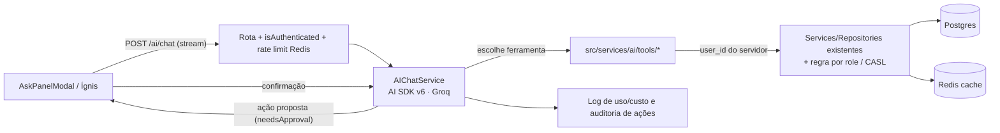

# Análise de IA no Fire OS — o que existe, o que está quebrado, e para onde ir

> Levantamento de 29/10/2026, branch `feat/ai-ui-mockups`. Documento de análise — nada foi alterado no código.

## TL;DR

1. **O que existe hoje é pequeno:** um endpoint `POST /ai/chat` (Groq + Vercel AI SDK) com **2 ferramentas** (total de técnicos, total de OS). O painel do Ígnis no frontend é **100% mockup** — respostas fixas por regex, não chama o backend.
2. **O endpoint atual provavelmente não funciona como deveria.** O código foi escrito para a API do AI SDK v4 (`maxSteps`, `parameters`), mas o projeto tem o **`ai@6.0.177`** instalado. Os `as any` escondem o erro de tipo. Resultado provável: a IA chama a ferramenta e para, sem escrever a resposta — por isso existe o fallback "A IA processou os dados mas não formulou uma frase".
3. **LangChain: minha recomendação é não trocar o AI SDK por LangChain.** O AI SDK v6 já tem agente (`ToolLoopAgent`), aprovação de ação (`needsApproval`), saída estruturada e embeddings — cobre ~90% do que o mockup do Ígnis precisa. O ponto onde **LangGraph.js** (não LangChain "puro") passa a valer a pena é se você quiser fluxos de várias etapas com estado salvo e pausa para aprovação humana entre requests. Detalhe na seção 4.
4. **Ordem sugerida:** consertar o que existe → dar ao Ígnis as ~10 ferramentas de leitura que o mockup já promete → ligar o frontend ao backend real → ações com confirmação → só então RAG/LangGraph/voz/visão.

---

## 1. Inventário: o que tem de IA hoje

### Backend (`Backend/`)

| Item | Onde | Situação |
|---|---|---|
| Dependências | `package.json`: `ai@^6.0.177`, `@ai-sdk/groq@^3.0.39`, `zod@^4` | Instaladas |
| Serviço | `src/services/ai/AIChatService.ts` | 1 chamada `generateText`, modelo `llama-3.3-70b-versatile` |
| Ferramentas | `getTecnicos`, `getEstatisticasOS` | Só retornam **totais** + nomes |
| Rota | `POST /ai/chat` (`src/routes.ts:190`), atrás de `isAuthenticated` + Zod (`aiChatSchema`) | OK |
| Controller | `src/api/ai/chat/route.ts` | Retorna `{ answer: string }` |
| Testes | — | **Nenhum** teste para `AIChatService` ou a rota |
| Variável de ambiente | `GROQ_API_KEY` | **Não está no `.env.example`** |
| Rate limit | — | Não existe em nenhuma rota (nem na de IA) |

### Frontend (`Frontend/`, Next 16 / React 19)

- `src/components/ai/AskPanelModal.tsx` (636 linhas) — o painel do **Ígnis**, aberto pelo `Header.tsx`.
- É um mockup bem pensado: perguntas agrupadas (Chamados, Técnicos, Clientes, Equipamentos), respostas com "ferramentas usadas", e **ações sugeridas** com confirmação (atribuir técnico, marcar urgente, notificar, redistribuir carga, agendar treinamento → link pro calendário real).
- **Não chama `/ai/chat`.** Todas as respostas são `cannedAnswers` por regex.
- O comentário no arquivo cita `docs/GUIA-IA-FIRE-OS.md` como o desenho de tool-calling — **esse arquivo não existe no repo** (este documento pode ocupar esse lugar).

### App mobile (`FireOS-App/`, Expo 52)

- Nenhuma IA. Mas é onde o técnico preenche `diagnostico` / `solucao` em campo (`modalFormTecnicoTickets`, `modalDetailOrderFormTecnico`…) — um ótimo lugar para IA (seção 5, fase 4).

### Infra que já ajuda a IA

- **Redis** (cache de totais/técnicos) → dá para cachear respostas e fazer rate limit por usuário.
- **BullMQ** (`uploadQueue`/`uploadWorker`) → tarefas de IA pesadas (resumo, classificação em lote, embeddings) podem rodar em fila, fora do request.
- **CASL** (`src/permissions/ability.ts`) e regra por role no `ListOrdemdeServicoService` → as ferramentas da IA **devem** reaproveitar isso (TECNICO só vê as próprias OS).
- **Deploy na Vercel** (`vercel.json`, `@vercel/node`) → funções serverless têm limite de tempo; agentes com muitos passos precisam de streaming ou fila.
- **Postgres 15-alpine** no `docker-compose` → **não tem pgvector**. Para RAG seria preciso trocar a imagem (`pgvector/pgvector:pg15`) e confirmar se o Postgres de produção suporta a extensão.

---

## 2. Problemas no que já existe

Em ordem de gravidade:

1. **API do AI SDK desatualizada (v4 rodando em v6).**
   - `maxSteps: 5` não existe mais no v6 — o padrão agora é `stopWhen: stepCountIs(1)`, ou seja, **um passo só**. O modelo chama a ferramenta e a geração termina sem texto final.
   - Ferramentas usam `parameters:`; no v6 é `inputSchema:` e o ideal é declarar com o helper `tool({...})`.
   - Os `as any` (no modelo, em cada tool e no objeto inteiro) desligam justamente o TypeScript que teria avisado.
   - A linha `result.text || (result as any).response?.messages?.slice(-1)[0]?.content` é um remendo para esse sintoma.
2. **Ferramentas pobres demais.** Só sabem totais. Nenhuma das perguntas do mockup (atrasadas, carga por técnico, secretaria, equipamento recorrente…) é respondível hoje.
3. **`getTecnicos` ignora a role** — qualquer usuário autenticado recebe a lista de nomes de todos os técnicos. Baixo risco, mas inconsistente com o resto do RBAC.
4. **Sem testes, sem rate limit, sem log de uso/custo.** Um usuário pode disparar chamadas ilimitadas à Groq.
5. **Sem histórico de conversa** — cada pergunta é isolada (`prompt: question`), então "e no mês passado?" não funciona.
6. **Nome do sistema no prompt** é "AlltiControl", enquanto o produto/persona é Fire OS / Ígnis.

---

## 3. Ferramentas primeiro — o que o Ígnis precisa para responder o mockup

Você pediu para começar pelas ferramentas. A ideia central: **o LLM não consulta o banco; ele escolhe entre funções fixas que nós escrevemos**, cada uma reaproveitando Services/Repositories existentes e respeitando a role do usuário. Assim não existe SQL gerado por IA e a permissão continua no backend.

### 3.1 Ferramentas de leitura (fase 2)

| Ferramenta (nome do mockup) | Pergunta que responde | Fonte de dados hoje | Esforço |
|---|---|---|---|
| `visaoGeralOS()` | "Como está a operação?" | `ListOrdemdeServicoService.getTotais()` (já com cache Redis 30s) | Baixo — já existe |
| `chamadosPorStatus(status)` | "Quantos abertos/pausados agora?" | Mesma service + rota `/statusordemdeServico/ordens` | Baixo |
| `cargaPorTecnico(periodo)` | "Qual técnico está mais sobrecarregado?" | Rota `/tecnicosordemdeServico/ordens` (`ListByTecnicosTickets`) | Baixo |
| `tempoMedioPorTecnico(periodo)` | "Quem demora mais por atendimento?" | Campos `duracao`, `startedAt`, `endedAt` da OS → novo `groupBy` | Médio |
| `osPorSecretaria(periodo)` | "Qual secretaria teve mais OS em setembro?" | `RelatorioSecretariaService` | Baixo |
| `chamadosPorCliente(periodo)` | "Qual cliente abriu mais chamados?" | `groupBy cliente_id` — novo | Baixo |
| `equipamentosRecorrentes(periodo)` | "Qual equipamento quebrou mais?" | `groupBy equipamentoid` / `patrimoniodoequipamento` — novo | Médio |
| `equipamentosAguardandoPeca()` | "Quantos aguardam peça?" | Provavelmente `controleDeMaquinasPendentes*` / `solicitacaoDeCompras` — **confirmar qual status representa "aguardando peça"** | Médio |
| `chamadosForaDoPrazo(limiteHoras)` / `osMaisAtrasada()` | "Quantas fora do prazo? Qual a mais atrasada?" | **Lacuna:** a OS não tem campo de prazo/SLA. Dá para aproximar ("sem atualização há X horas" via `updatedAt` + `prioridade`), mas a regra de negócio precisa ser definida por você | Médio + decisão |
| `detalheOS(numeroOS)` | "O que aconteceu na OS #48217?" | `OrdemdeServicoRepository` (com `diagnostico`, `solucao`, `observacoes`, `atividades`) | Baixo |

Regras para todas:
- Recebem o `user_id` pelo **contexto do servidor**, nunca como argumento que o modelo preenche.
- Retornam **JSON enxuto** (top N, agregados), não listas inteiras — menos tokens, menos alucinação.
- Ficam num lugar próprio (ex.: `src/services/ai/tools/`) e cada uma tem teste unitário com o service mockado, como o resto do projeto.

### 3.2 Ferramentas de ação (fase 3) — sempre com confirmação

| Ação do mockup | Existe no backend? |
|---|---|
| Atribuir OS a técnico | Sim — `UpdateOrdemdeServicoService` (`tecnico_id`) |
| Marcar como urgente | Sim — `prioridade_id` na OS |
| Redistribuir carga | Sim, como N atribuições |
| Agendar (treinamento/visita) | Parcial — model `Event` + `agendadoEm` na OS |
| **Notificar técnicos** | **Não existe** sistema de notificação (nem push no app Expo). É uma feature à parte. |

No AI SDK v6 isso é natural: a ferramenta é marcada com `needsApproval: true`, o modelo **propõe** a ação, o frontend mostra o botão de confirmação (que o mockup já desenhou) e só então o backend executa — passando pelo mesmo CASL/`authorizeOwnership` das rotas normais.

---

## 4. LangChain faz sentido aqui?

| | **Vercel AI SDK v6** (já instalado) | **LangChain.js** | **LangGraph.js** |
|---|---|---|---|
| Tool calling + loop de agente | Sim (`ToolLoopAgent`, `stopWhen`) | Sim | Sim |
| Aprovação humana de ação | Sim (`needsApproval`) | Via LangGraph | Sim (`interrupt`), com estado salvo |
| Estado persistido entre requests (checkpoint) | Você monta (Postgres/Redis) | — | Nativo (checkpointer Postgres) |
| Fluxos com ramificação/etapas explícitas | Manual | Chains (legado) | Ponto forte |
| Streaming para React/Next | Excelente (`useChat`) | Médio | Médio |
| RAG (embeddings + vector store) | `embed`/`embedMany`, store você escolhe | Muitos integradores prontos | Usa os do LangChain |
| Peso / curva de aprendizado | Baixo | Alto, muitas abstrações | Médio-alto |
| Encaixe com o padrão do repo (Service + Repository + Zod) | Direto | Abstrações próprias por cima | Grafo por cima dos Services |

**Recomendação:**
- **Agora:** ficar no AI SDK v6. Trocar por LangChain para fazer o que o Ígnis precisa hoje seria adicionar uma camada sem ganho, e você ainda teria que consertar os mesmos problemas da seção 2.
- **Quando LangGraph.js entra:** se o Ígnis evoluir para fluxos tipo *"triagem de chamado novo → classifica → sugere técnico → espera aprovação do gestor (horas depois) → atribui → notifica"*. Aí estado persistido + `interrupt` + retomar depois é exatamente o que o LangGraph resolve bem e o AI SDK não. Dá para usar LangGraph **só nesse fluxo**, coexistindo com o AI SDK no chat.
- **Para estudo/portfólio:** se a meta for aprender LangChain/LangGraph (vale para currículo), a fase 5 abaixo é um bom lugar isolado para isso, sem comprometer o chat.

**Sobre Groq:** é rápido e barato, ótimo para o chat. Limitações a saber: **não oferece embeddings** (RAG precisaria de outro provedor — OpenAI, Voyage, Cohere, ou modelo local) e tem rate limit apertado no plano gratuito. Como o AI SDK abstrai o provedor, dá para usar Groq no chat e outro provedor só onde precisar, trocando uma linha.

---

## 5. Roadmap de features de IA (priorizado)

### Fase 1 — Consertar a base (1–2 dias)
- Migrar `AIChatService` para a API v6: `tool({ inputSchema })`, `stopWhen: stepCountIs(5)`, remover os `as any`.
- `GROQ_API_KEY` no `.env.example`; renomear "AlltiControl" no prompt.
- Testes unitários do service com o modelo mockado (`MockLanguageModelV3` do `ai/test`).
- Rate limit por usuário na rota `/ai/chat` usando o Redis existente.

### Fase 2 — Ígnis responde de verdade (≈1 semana)
- As ferramentas da seção 3.1, em `src/services/ai/tools/`.
- Ligar `AskPanelModal` ao backend; trocar `cannedAnswers` pela resposta real (manter as perguntas sugeridas como atalhos).
- Histórico curto da conversa (enviar `messages` em vez de `prompt`).
- Streaming (`streamText` + `useChat`) para a resposta aparecer enquanto gera — também resolve limite de tempo da Vercel.
- Resposta estruturada: texto + `toolsUsed` + `suggestedAction` (o formato que o mockup já espera).

### Fase 3 — Ações com confirmação (≈1 semana)
- Ferramentas de ação (seção 3.2) com `needsApproval`.
- Log de auditoria: quem confirmou qual ação sugerida pela IA.
- "Notificar técnico" depende de criar notificações (push Expo ou in-app) — avaliar como feature separada.

### Fase 4 — IA dentro dos fluxos, não só no chat
Funcionalidades que não precisam de chat e costumam ter mais impacto no dia a dia:
- **Triagem de OS nova:** a partir de `descricaodoProblemaouSolicitacao`, sugerir `tipodeChamado`, `prioridade` e atividades padrão (`AtividadePadrao`) via `generateObject` + Zod. Roda na fila BullMQ após o create.
- **Ajuda ao técnico no app:** ditar diagnóstico/solução por voz (Groq oferece Whisper para transcrição) e a IA reescreve em texto técnico limpo.
- **Resumo automático da OS** ao concluir (para o relatório da secretaria e para o cliente).
- **Relatório mensal narrado:** o `RelatorioSecretariaService` já gera os números; a IA escreve o parágrafo de análise.
- **Visão computacional (opcional):** analisar as fotos da OS (já no Cloudinary) para identificar equipamento/patrimônio — verificar qual modelo com visão está disponível na Groq no momento.

### Fase 5 — Conhecimento e agentes (onde LangChain/LangGraph podem entrar)
- **RAG sobre o histórico de OS:** "já resolvemos esse defeito antes?" — embeddings de `diagnostico` + `solucao`, buscando OS parecidas para o técnico. Requer pgvector (ou um vector store externo) e provedor de embeddings.
- **RAG sobre documentação técnica** (`documentacaoTecnica`, manuais em PDF).
- **Agente de triagem com aprovação** em LangGraph.js (seção 4).
- **Detecção de padrões** (job agendado): equipamento com defeito recorrente, técnico com tempo médio subindo, secretaria com pico de chamados → alerta proativo do Ígnis.

---

## 6. Arquitetura proposta (fases 1–3)

---

## 7. Segurança, custo e qualidade

- **Permissão sempre no backend:** a ferramenta recebe o `user_id` do token; o modelo nunca escolhe "de quem" são os dados.
- **Prompt injection:** textos livres das OS (`observacoes`, `descricao…`) voltam para o modelo pelas ferramentas. Tratá-los como dados, nunca como instrução, e nunca deixar uma ação rodar sem confirmação humana.
- **Dados pessoais:** nomes de contato/assinante não precisam ir para o LLM — enviar só o necessário.
- **Custo/uso:** registrar tokens por chamada (o `result.usage` do AI SDK já entrega) — útil também como métrica de portfólio.
- **Avaliação:** um conjunto pequeno de perguntas reais com resposta esperada (as do mockup servem) rodando no CI com o modelo mockado, e um script manual contra o modelo de verdade.

---

## 8. Decisões que são suas

1. **AI SDK puro vs. introduzir LangGraph.js** — e se sim, em qual fluxo (minha sugestão: só na triagem com aprovação, fase 5).
2. **Definição de "fora do prazo" / SLA** — prazo fixo por prioridade? por tipo de chamado? Hoje não existe no schema.
3. **O que é "aguardando peça"** no modelo de dados (qual tabela/status).
4. **Notificações** — vale construir (push no app) já na fase 3 ou deixar a ação de fora por enquanto?
5. **Provedor de embeddings** para a fase 5 (Groq não tem) e se o Postgres de produção aceita pgvector.
6. **Onde este documento mora** — o frontend referencia `docs/GUIA-IA-FIRE-OS.md`; dá para mover/renomear este arquivo para lá.

## 9. Próximo passo sugerido

Fase 1 inteira num PR pequeno (consertar API v6 + testes + rate limit + `.env.example`), seguido de um PR por grupo de ferramentas da fase 2. A fase 1 é pré-requisito de tudo e mostra rápido se o Groq + AI SDK v6 responde bem com ferramentas reais.
