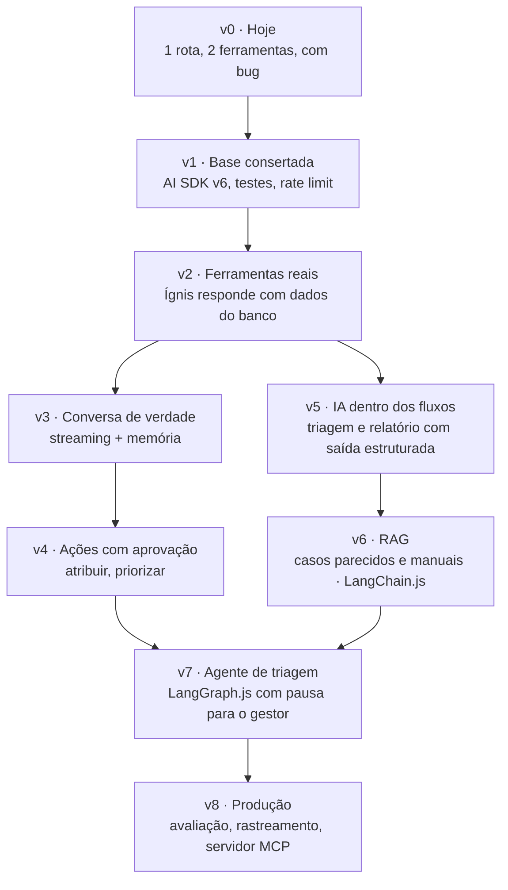
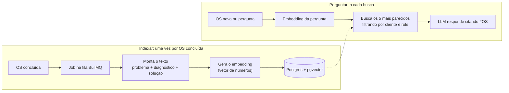
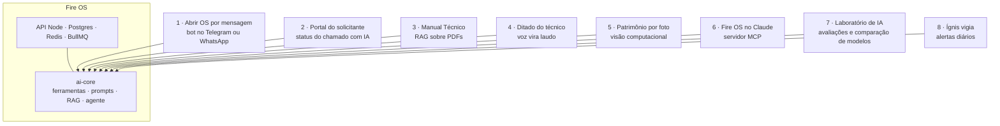

# Trilha do Ígnis

> Como o assistente do Fire OS pode evoluir de uma rota com duas ferramentas até um agente com RAG, e o que você aprende em cada etapa para fechar um currículo fullstack com IA em TypeScript.

- **9 versões** (v0 a v8)
- **Três ritmos:** 14 dias intensivo, 30 dias com preparação para vagas, 32 dias completo
- **Stack:** Node · TypeScript · AI SDK · LangChain.js · LangGraph.js · pgvector

Versão online (com fluxogramas e checklist interativo): https://claude.ai/artifact/K6Y35vqmYDt5bqwVbgYnvB
Análise técnica completa: [`ANALISE-IA-FIRE-OS.md`](./ANALISE-IA-FIRE-OS.md)

## Sumário

1. [O que existe hoje](#1-o-que-existe-hoje)
2. [Fluxograma das versões](#2-fluxograma-das-versões)
3. [O que cada versão constrói e ensina](#3-o-que-cada-versão-constrói-e-ensina)
4. [Plano por dias](#4-plano-por-dias)
5. [Vale a pena colocar RAG?](#5-vale-a-pena-colocar-rag)
6. [Como fica no seu currículo](#6-como-fica-no-seu-currículo)
7. [Um projeto que cresce](#7-um-projeto-que-cresce)
8. [Suas perguntas](#8-suas-perguntas)
9. [Glossário](#9-glossário)

---

## 1. O que existe hoje

*Análise do repositório em 29/10/2026.*

Analisei as três partes do projeto: a API (82 services, 97 arquivos de teste, CI no GitHub Actions), o painel em Next.js 16 e o app do técnico em Expo. A maior parte da IA hoje é **tela desenhada**: o visual está pronto, mas os dados são fixos no código. Isso é uma vantagem, porque cada mockup vira uma meta concreta de estudo.

| Item | Situação | O que é | Onde |
|---|---|---|---|
| Rota `POST /ai/chat` | 🟠 real, com bug | Groq (`llama-3.3-70b-versatile`) com Vercel AI SDK. Duas ferramentas: total de técnicos e total de OS. Escrita na API antiga (v4) rodando no `ai@6`, então para no 1º passo e não escreve resposta. | `Backend/src/services/ai/AIChatService.ts` |
| Ígnis (painel de perguntas) | 🟡 mockup | Perguntas por grupo, ações sugeridas com confirmação, multi-seleção de técnicos. Respostas fixas, escolhidas por regex. Não chama o backend. | `Frontend/src/components/ai/AskPanelModal.tsx` |
| Triagem com IA | 🟡 mockup | Fluxo em etapas: classificando → **buscando casos parecidos** → sugerindo técnico → aguardando aprovação. É literalmente um pipeline de RAG + agente com aprovação humana. | `Frontend/src/app/dashboard/(admin)/relatorios/triagem-ia` |
| Relatório mensal (insights) | 🟡 mockup | Números do mês + destaques escritos em texto + pontos de atenção (equipamento recorrente, técnico sobrecarregado). | `Frontend/src/app/dashboard/(admin)/relatorios/insights` |
| Roteiro inteligente | 🟡 mockup | Ordem de visitas do técnico no dia. A otimização de rota é algoritmo (API de mapas), não LLM. O LLM só explica o porquê de cada parada. | `Frontend/src/app/dashboard/(admin)/relatorios/rota-inteligente` |
| App do técnico | ⚪ sem IA | É onde o técnico escreve `diagnostico` e `solucao` em campo. Esse texto é a matéria-prima do RAG mais à frente. | `FireOS-App/src` (Expo 52) |
| Infra que ajuda | 🟢 pronta | Redis (cache e rate limit), BullMQ (jobs de IA fora do request), CASL (permissão por role), Zod (saída estruturada), testes com TestContainers. | `Backend/src/redis` · `queue` · `permissions` |
| Lacunas | ⚪ não existe | Sem campo de prazo/SLA na OS, sem notificações (push), sem pgvector no Postgres, sem provedor de embeddings (a Groq não oferece), sem rate limit nem testes na rota de IA. | `Backend/prisma/schema.prisma` |

> **Sobre o nome:** no código o assistente se chama **Ígnis** (`ASSISTANT_NAME` no `AskPanelModal.tsx`).

---

## 2. Fluxograma das versões

Cada versão é complementar à anterior: nada é jogado fora. Os dois caminhos depois da v2 podem ser feitos em qualquer ordem e se juntam no agente da v7.



---

## 3. O que cada versão constrói e ensina

Em cada uma: o que você constrói, os conceitos de LLM que aprende, a tecnologia, qual mockup vira real, e uma linha pronta para o currículo. Os dias seguem o plano completo (32 dias).

### v0 · Hoje — ponto de partida

- **Você constrói:** rota `/ai/chat` com Groq e 2 ferramentas; 4 telas de IA desenhadas com dados fixos.
- **Você aprende:** ler código de IA existente e achar onde quebra.
- **Tecnologia:** Groq, Vercel AI SDK.
- **Torna real:** nada ainda, é o ponto de partida.

### v1 · Base consertada — dias 1 a 4

- **Você constrói:**
  - Migrar `AIChatService` para a API do AI SDK v6 (`tool`, `inputSchema`, `stopWhen`)
  - Testes com modelo falso (`MockLanguageModel`)
  - Rate limit por usuário no Redis e registro de tokens gastos
- **Você aprende:** o que é LLM, token, prompt e system prompt; como funciona tool calling por dentro; testar código que depende de IA.
- **Tecnologia:** AI SDK v6, Groq, Vitest, Redis.
- **Torna real:** deixa a rota atual funcionando de verdade.
- **Currículo:** *Corrigi a integração com LLM (Vercel AI SDK v6 + Groq), adicionando testes determinísticos e rate limit por usuário com Redis.*

### v2 · Ferramentas reais — dias 5 a 9

- **Você constrói:**
  - ~10 ferramentas que reaproveitam os Services existentes: carga por técnico, OS por secretaria, equipamento recorrente…
  - Permissão por role dentro de cada ferramenta
  - Painel do Ígnis ligado ao backend
- **Você aprende:** desenhar boas ferramentas (nome, descrição, entrada pequena); por que a IA não gera SQL (ela escolhe funções suas); definir regra de negócio (SLA) antes de pedir à IA.
- **Tecnologia:** AI SDK, Zod, Prisma `groupBy`, Next.js.
- **Torna real:** o painel do Ígnis (`AskPanelModal`).
- **Currículo:** *Construí um assistente com tool calling sobre dados operacionais reais, respeitando RBAC (CASL) em cada ferramenta.*

### v3 · Conversa de verdade — dias 10 a 12

- **Você constrói:**
  - Resposta em streaming (`streamText` + `useChat`)
  - Histórico curto da conversa
  - Resposta estruturada: texto + ferramentas usadas + ação sugerida
- **Você aprende:** streaming e por que ele resolve o limite de tempo da Vercel; janela de contexto e custo do histórico; saída estruturada com Zod.
- **Tecnologia:** AI SDK UI, Next.js, Zod.
- **Torna real:** o Ígnis passa a lembrar a pergunta anterior ("e no mês passado?").
- **Currículo:** *Implementei chat com streaming e memória de conversa em Next.js + Node.*

### v4 · Ações com aprovação — dias 13 a 15

- **Você constrói:**
  - Ferramentas que alteram dados: atribuir técnico, marcar urgente, redistribuir
  - Aprovação antes de executar (`needsApproval`)
  - Log de auditoria das ações aprovadas
- **Você aprende:** human-in-the-loop; prompt injection (texto de OS tentando dar ordens à IA); por que toda ação passa pelas mesmas permissões das rotas normais.
- **Tecnologia:** AI SDK `needsApproval`, CASL, Prisma.
- **Torna real:** os botões de ação do Ígnis (atribuir, priorizar).
- **Currículo:** *Desenhei ações executadas por IA com aprovação humana obrigatória e trilha de auditoria.*

### v5 · IA dentro dos fluxos — dias 16 a 19

- **Você constrói:**
  - Classificar OS nova: tipo, prioridade, atividades padrão (`generateObject` + Zod)
  - Rodar a classificação na fila BullMQ
  - Relatório mensal com análise escrita pela IA
- **Você aprende:** IA sem chat (extração e classificação); jobs assíncronos para IA; primeiro conjunto de avaliação (20 OS com resposta esperada).
- **Tecnologia:** AI SDK `generateObject`, BullMQ, Zod.
- **Torna real:** a etapa "classificando" da triagem e a tela de insights.
- **Currículo:** *Automatizei a triagem de ordens de serviço com saída estruturada (Zod) processada em fila BullMQ.*

### v6 · RAG: casos parecidos e manuais — dias 20 a 25

- **Você constrói:**
  - pgvector no Postgres e indexação de OS concluídas via job
  - Busca dos casos mais parecidos com filtro por cliente
  - Ferramenta `buscarCasosParecidos` no Ígnis, com citação das OS
- **Você aprende:** embeddings e similaridade de cosseno; chunking, top-k, busca híbrida; medir se a busca acerta (hit rate).
- **Tecnologia:** **LangChain.js**, pgvector, embeddings, BullMQ.
- **Torna real:** a etapa "buscando casos parecidos" da triagem.
- **Currículo:** *Implementei RAG com LangChain.js e pgvector sobre o histórico de atendimentos, com filtros de multi-tenant e citação de fontes.*

### v7 · Agente de triagem — dias 26 a 29

- **Você constrói:**
  - Grafo: classificar → buscar parecidos → sugerir técnico → esperar gestor → atribuir
  - Estado salvo no Postgres (checkpointer)
  - Pausa até o gestor aprovar, mesmo horas depois
- **Você aprende:** agentes como grafo de etapas; estado persistido e retomada; quando LangGraph vale mais que um loop simples.
- **Tecnologia:** **LangGraph.js**, Postgres checkpointer.
- **Torna real:** a tela de triagem inteira, com a aprovação do gestor.
- **Currículo:** *Construí um agente multi-etapas com LangGraph.js, estado persistido e aprovação humana assíncrona.*

### v8 · Produção — dias 30 a 32

- **Você constrói:**
  - Rastrear cada chamada de IA (Langfuse ou LangSmith)
  - Avaliações rodando no CI
  - Servidor MCP expondo as ferramentas do Fire OS
- **Você aprende:** observabilidade de LLM (custo, latência, erros); evals como teste de regressão; MCP.
- **Tecnologia:** Langfuse / LangSmith, GitHub Actions, MCP SDK.
- **Torna real:** fecha o ciclo: dá para provar em entrevista que a IA funciona e quanto custa.
- **Currículo:** *Coloquei LLMs em produção com tracing, avaliações automatizadas no CI e um servidor MCP.*

---

## 4. Plano por dias

Três ritmos para escolher. Se um dia virar dois, tudo bem. Marque com `[x]` o que concluir.

### Ritmo A · Intensivo · 14 dias (3 a 4 h/dia)

Mantém o que mais pesa no currículo (ferramentas, streaming, saída estruturada, RAG com LangChain.js e agente com LangGraph.js) e corta refinamentos.

**Semana 1 · Ígnis funcionando**

*v1 · Base consertada (dias 1 a 2)*
- [ ] **Dia 01 · Conceitos + conserto** — LLM, token e system prompt num script com a Groq; migrar `AIChatService` para `tool({ inputSchema })` e `stopWhen`
- [ ] **Dia 02 · Testes e custo** — testes com `MockLanguageModel`; rate limit no Redis; log de tokens (`result.usage`)

*v2 · Ferramentas reais (dias 3 a 4)*
- [ ] **Dia 03 · Ferramentas que reaproveitam services** — `visaoGeralOS`, `chamadosPorStatus`, `cargaPorTecnico`, `osPorSecretaria`, com permissão por role
- [ ] **Dia 04 · Agregações novas** — `tempoMedioPorTecnico` e `equipamentosRecorrentes` com Prisma `groupBy`

*v3 · Conversa de verdade (dia 5)*
- [ ] **Dia 05 · Streaming e front ligado** — `streamText` + `useChat`; `AskPanelModal` chamando o backend com histórico curto

*v5 · IA dentro dos fluxos (dias 6 a 7)*
- [ ] **Dia 06 · Saída estruturada na fila** — `generateObject` + Zod classificando OS nova, rodando num job BullMQ
- [ ] **Dia 07 · Folga e avaliação** — recuperar atrasos; 20 OS com classificação esperada para medir acertos

**Semana 2 · RAG e agente**

*v6 · RAG (dias 8 a 10)*
- [ ] **Dia 08 · Embeddings e pgvector** — similaridade de cosseno com 3 frases; imagem pgvector no Docker e migration
- [ ] **Dia 09 · Indexar com LangChain.js** — text splitter + `PGVectorStore`; job que indexa cada OS concluída
- [ ] **Dia 10 · RAG no Ígnis** — busca de casos parecidos com filtro por cliente; ferramenta `buscarCasosParecidos` citando #OS

*v7 · Agente de triagem, inclui a aprovação da v4 (dias 11 a 13)*
- [ ] **Dia 11 · LangGraph.js** — grafo, nós e estado; grafo classificar → buscar parecidos → sugerir técnico
- [ ] **Dia 12 · Aprovação do gestor** — `interrupt` + checkpointer Postgres; atribuição só depois de aprovada
- [ ] **Dia 13 · Front da triagem** — ligar a tela `triagem-ia` ao agente

*v8 · Vitrine (dia 14)*
- [ ] **Dia 14 · Rastreamento e currículo** — tracing com Langfuse ou LangSmith; README com arquitetura, GIF de demo e linhas do currículo

**O que fica de fora no intensivo** (bons próximos passos depois das 2 semanas):
- **v4 como etapa própria:** a aprovação humana é aprendida dentro do agente LangGraph (dia 12), só para a atribuição de técnico.
- **Ferramenta de SLA** (chamados fora do prazo): depende de você definir a regra de prazo antes.
- **Relatório mensal com IA** (tela de insights).
- **Busca híbrida e medição de hit rate** do RAG.
- **Prompt injection** como dia de estudo dedicado.
- **Servidor MCP e evals no CI.**

### Ritmo B · Preparação para vagas · 30 dias (2 a 3 h/dia)

Três semanas construindo o Ígnis, cada uma fechando com um dia de revisão, e uma quarta semana para currículo, portfólio e entrevista. Os dias marcados 📋 são de preparação, não de código.

**Semana 1 · Fundamentos e Ígnis funcionando** (v1–v3)
- [ ] **Dia 01 · Conceitos de LLM** — token, prompt, system prompt e janela de contexto; script solto em TS chamando a Groq
- [ ] **Dia 02 · Conserto da rota** — migrar `AIChatService` para `tool({ inputSchema })` e `stopWhen`; remover os `as any`
- [ ] **Dia 03 · Testes e custo** — testes com `MockLanguageModel`; rate limit no Redis; log de tokens
- [ ] **Dia 04 · Ferramentas que reaproveitam services** — `visaoGeralOS`, `chamadosPorStatus`, `cargaPorTecnico`, `osPorSecretaria`, com permissão por role
- [ ] **Dia 05 · Agregações novas** — `tempoMedioPorTecnico` e `equipamentosRecorrentes` com Prisma `groupBy`
- [ ] **Dia 06 · Streaming e front ligado** — `streamText` + `useChat`; `AskPanelModal` chamando o backend com histórico curto
- [ ] **Dia 07 · Revisão da semana** 📋 — escrever com suas palavras o que é tool calling e agente, num `.md` em `estudos-pleno`

**Semana 2 · IA nos fluxos e RAG** (v5–v6)
- [ ] **Dia 08 · Saída estruturada** — `generateObject` + Zod classificando uma OS nova
- [ ] **Dia 09 · Fila e avaliação** — classificação num job BullMQ; 20 OS com resposta esperada para medir acertos
- [ ] **Dia 10 · Embeddings na mão** — gerar embeddings de 3 frases e calcular a similaridade de cosseno
- [ ] **Dia 11 · pgvector** — imagem pgvector no Docker; migration com coluna vector
- [ ] **Dia 12 · LangChain.js** — text splitter + `PGVectorStore`; job que indexa cada OS concluída
- [ ] **Dia 13 · RAG no Ígnis** — busca de casos parecidos com filtro por cliente; ferramenta `buscarCasosParecidos` citando #OS
- [ ] **Dia 14 · Revisão da semana** 📋 — gravar um áudio de 2 minutos explicando quando usar RAG e quando usar ferramenta

**Semana 3 · Agente e produção** (v7–v8)
- [ ] **Dia 15 · LangGraph.js** — grafo, nós, arestas e estado; exemplo pequeno
- [ ] **Dia 16 · Grafo da triagem** — classificar → buscar parecidos → sugerir técnico
- [ ] **Dia 17 · Aprovação do gestor** — `interrupt` + checkpointer Postgres; atribuição só depois de aprovada
- [ ] **Dia 18 · Front da triagem** — ligar a tela `triagem-ia` ao agente
- [ ] **Dia 19 · Observabilidade** — tracing com Langfuse ou LangSmith: custo e latência por chamada
- [ ] **Dia 20 · Um refinamento à escolha** — busca híbrida no RAG ou teste de prompt injection com uma OS maliciosa
- [ ] **Dia 21 · Revisão da semana** 📋 — desenhar a arquitetura do Ígnis no papel, sem olhar o código

**Semana 4 · Preparação para vagas** (vitrine)
- [ ] **Dia 22 · README do projeto** 📋 — diagrama da camada de IA, GIF de demo e como rodar
- [ ] **Dia 23 · Currículo e LinkedIn** 📋 — usar os textos da seção 6; post curto contando como fez o RAG
- [ ] **Dia 24 · Perguntas de entrevista** 📋 — responder por escrito as perguntas da seção 8
- [ ] **Dia 25 · Mini RAG fora do Fire OS** 📋 — do zero, num script, sobre um PDF qualquer: prova que você aprendeu e não só adaptou
- [ ] **Dia 26 · System design do Ígnis** 📋 — como escalar para 100 clientes: custo por pergunta, cache, fila, limites do provedor
- [ ] **Dia 27 · Comparar provedores** 📋 — trocar a Groq por outro provedor no AI SDK (uma linha) e comparar qualidade, custo e tempo no conjunto de avaliação
- [ ] **Dia 28 · Entrevista simulada** 📋 — com alguém ou com o Claude, defendendo as escolhas do projeto
- [ ] **Dia 29 · Candidaturas** 📋 — ajustar o currículo para cada vaga e aplicar
- [ ] **Dia 30 · Retrospectiva** 📋 — o que ficou fraco e qual é o próximo passo (MCP, evals no CI, prompt injection)

### Ritmo C · Completo · 32 dias (2 a 3 h/dia)

Cobre as 9 versões. Os dias na seção 3 seguem este ritmo.

*v1 · Base consertada (dias 1 a 4)*
- [ ] **Dia 01 · Conceitos: LLM, token, prompt, system prompt** — script solto em TS chamando a Groq com `generateText`
- [ ] **Dia 02 · Tool calling na prática** — migrar `AIChatService` para `tool({ inputSchema })` e `stopWhen: stepCountIs(5)`; remover os `as any`
- [ ] **Dia 03 · Testar código de IA** — testes do `AIChatService` com `MockLanguageModel`; `GROQ_API_KEY` no `.env.example`
- [ ] **Dia 04 · Custo e abuso** — rate limit por usuário no Redis e log de `result.usage` (tokens)

*v2 · Ferramentas reais (dias 5 a 9)*
- [ ] **Dia 05 · Primeiras ferramentas** — pasta `src/services/ai/tools` com `visaoGeralOS` e `chamadosPorStatus`
- [ ] **Dia 06 · Reaproveitar services** — `cargaPorTecnico` e `osPorSecretaria` (`RelatorioSecretariaService`)
- [ ] **Dia 07 · Agregações novas** — `tempoMedioPorTecnico` e `equipamentosRecorrentes` com Prisma `groupBy`
- [ ] **Dia 08 · Regra de negócio** — definir SLA por prioridade; ferramenta `chamadosForaDoPrazo`
- [ ] **Dia 09 · Front ligado** — `AskPanelModal` chama `/ai/chat`; manter perguntas sugeridas como atalho

*v3 · Conversa de verdade (dias 10 a 12)*
- [ ] **Dia 10 · Streaming** — `streamText` no backend e `useChat` no Next.js
- [ ] **Dia 11 · Memória** — enviar `messages` em vez de `prompt`; limitar o histórico
- [ ] **Dia 12 · Resposta estruturada** — texto + ferramentas usadas + ação sugerida no formato do mockup

*v4 · Ações com aprovação (dias 13 a 15)*
- [ ] **Dia 13 · Primeira ação** — `atribuirTecnico` com `needsApproval` e botão de confirmar
- [ ] **Dia 14 · Mais ações + auditoria** — `marcarUrgente`, redistribuir; tabela de auditoria
- [ ] **Dia 15 · Segurança** — testar prompt injection com uma OS cujo texto tenta dar ordens

*v5 · IA dentro dos fluxos (dias 16 a 19)*
- [ ] **Dia 16 · Saída estruturada** — `generateObject` + Zod para classificar uma OS nova
- [ ] **Dia 17 · Fila** — rodar a classificação num job BullMQ após criar a OS
- [ ] **Dia 18 · Relatório** — insights do mês: números do banco + texto escrito pela IA
- [ ] **Dia 19 · Avaliação** — 20 OS reais com classificação esperada; medir acertos

*v6 · RAG (dias 20 a 25)*
- [ ] **Dia 20 · Embeddings na mão** — gerar embeddings de 3 frases e calcular a similaridade de cosseno
- [ ] **Dia 21 · pgvector** — imagem pgvector no Docker; migration com coluna vector
- [ ] **Dia 22 · LangChain.js** — text splitter + `PGVectorStore`; indexar OS concluídas num job
- [ ] **Dia 23 · Busca** — endpoint de casos parecidos com filtro por cliente e role
- [ ] **Dia 24 · RAG no Ígnis** — ferramenta `buscarCasosParecidos`, respondendo com citação das #OS
- [ ] **Dia 25 · Qualidade** — medir hit rate; testar busca híbrida (vetor + full-text)

*v7 · Agente de triagem (dias 26 a 29)*
- [ ] **Dia 26 · Conceitos** — grafo, nós, arestas e estado no LangGraph.js; exemplo pequeno
- [ ] **Dia 27 · Grafo da triagem** — classificar → buscar parecidos → sugerir técnico
- [ ] **Dia 28 · Pausa e retomada** — `interrupt` + checkpointer Postgres para a aprovação do gestor
- [ ] **Dia 29 · Front** — ligar a tela `triagem-ia` ao agente

*v8 · Produção (dias 30 a 32)*
- [ ] **Dia 30 · Observabilidade** — tracing com Langfuse ou LangSmith: custo e latência por chamada
- [ ] **Dia 31 · MCP** — servidor MCP expondo as ferramentas de leitura do Fire OS
- [ ] **Dia 32 · Vitrine** — README com arquitetura, GIF de demo, evals no CI e texto para o currículo

---

## 5. Vale a pena colocar RAG?

**Sim, mas não para tudo.** RAG serve para o modelo responder com base em **textos** do seu sistema que ele nunca viu. O Fire OS tem muito texto útil: descrição do problema, diagnóstico, solução, observações, laudos e documentação técnica. Agora, perguntas de **número** ("quantas OS abertas?") não são RAG: são ferramentas que consultam o banco (v2). Separar essas duas coisas é a lição mais importante desta seção, e é pergunta comum em entrevista.

**Use RAG quando…**
- a resposta está escrita em texto livre (diagnósticos, soluções, manuais)
- a pessoa descreve com outras palavras ("não puxa papel" deve achar "rolete gasto")
- você precisa citar a fonte (#OS, página do manual)

**Não use RAG quando…**
- a pergunta é contagem, soma, média ou ranking: use ferramenta + SQL/Prisma
- você já sabe o ID (histórico do patrimônio 00245): é uma consulta normal
- há pouco texto ainda: busca por palavra (`pg_trgm`, full-text) pode bastar

### Como o RAG funciona no Fire OS



### Funcionalidades com RAG para o Fire OS

Em ordem sugerida de implementação. As duas primeiras já têm tela desenhada.

| # | Funcionalidade | Exemplo | O que faz | Status | Nível |
|---|---|---|---|---|---|
| 1 | Casos parecidos na triagem | "Impressora HP não puxa papel na EMEF Monteiro Lobato" | Ao abrir uma OS, mostra as 3 a 5 OS concluídas mais parecidas e como foram resolvidas. É a etapa "buscando" da tela de triagem. | torna real `triagem-ia` | inicial |
| 2 | "Já resolvemos isso antes?" no app | "Nobreak apitando e desligando sozinho" | O técnico, em campo, recebe a solução que funcionou em casos parecidos, com o número das OS de origem para conferir. | nova no app | inicial |
| 3 | Busca semântica de OS | "problema de rede no laboratório de informática" | Campo de busca no painel que encontra por significado, não só por palavra exata. Bom para aprender busca híbrida. | nova | inicial |
| 4 | Ígnis consulta o histórico | "Como costumamos resolver estabilizador queimado?" | Vira mais uma ferramenta do Ígnis (`buscarCasosParecidos`). O agente decide sozinho quando usar SQL e quando usar RAG. | amplia o Ígnis | intermediário |
| 5 | Chat com a documentação técnica | "Qual a tensão de saída do estabilizador modelo X?" | Indexa `documentacaoTecnica` e manuais em PDF. Ensina carregar PDF, chunking e citar página. | nova | intermediário |
| 6 | Laudo técnico assistido | rascunho a partir de laudos parecidos | Busca laudos de equipamentos do mesmo tipo e gera um rascunho que o técnico revisa e assina. | nova | intermediário |
| 7 | Detector de chamado duplicado | mesmo problema, mesma unidade, aberto 2 vezes | Antes de salvar, avisa: "parece a OS #48210, aberta ontem". Ensina a escolher um limite de similaridade. | nova | intermediário |
| 8 | Base de conhecimento automática | "Como resolver: rolete de impressora gasto" | Agrupa OS parecidas e gera um artigo de procedimento, que é indexado de novo e alimenta o próprio RAG. | nova | avançado |

### Decisões técnicas do RAG

| Peça | Opção sugerida | Por quê |
|---|---|---|
| Banco vetorial | `pgvector` no Postgres que você já tem | Sem serviço novo; a busca respeita os mesmos filtros de cliente e role. No Docker, trocar a imagem para `pgvector/pgvector:pg15`. |
| Embeddings | Para estudar: modelo local (Ollama). Em produção: um provedor pago barato | A Groq não gera embeddings. Pelo AI SDK, trocar de provedor é uma linha. |
| Pipeline | LangChain.js (loaders, text splitters, `PGVectorStore`) | É onde LangChain realmente economiza código, e conta no currículo. |
| Indexação | Job BullMQ ao concluir OS | Mesmo padrão do upload de fotos; não atrasa o request. |
| Segurança | Filtro por `cliente_id` e role na busca | Sem isso, um cliente veria texto de OS de outro cliente na resposta. |

---

## 6. Como fica no seu currículo

O Fire OS já mostra uma stack fullstack sólida. A trilha adiciona a camada de IA por cima dela, e esse é o diferencial: você não aprendeu IA num tutorial, aplicou num sistema com usuários, permissões, fila e testes.

### O que você já tem hoje (tirado do repositório)

- **Backend:** Node.js, TypeScript, Express, Prisma, PostgreSQL, Redis, BullMQ, Zod, CASL (RBAC), JWT
- **Frontend e mobile:** Next.js, React, React Native, Expo
- **Qualidade e infra:** Vitest, Supertest, TestContainers, Docker, GitHub Actions, ESLint, Vercel, Cloudinary

### O que a trilha adiciona

| Tecnologia ou prática | O que você faz com ela no Fire OS | Versão | Plano |
|---|---|---|---|
| **Vercel AI SDK** | Chamar LLMs, tool calling, streaming e saída estruturada | v1–v5 | 14 e 32 dias |
| **Groq** (provedor de LLM) | Rodar o modelo do Ígnis com baixa latência e custo | v1 | 14 e 32 dias |
| **Tool calling** | O Ígnis consulta o banco por funções suas, com permissão por role | v2 | 14 e 32 dias |
| **Streaming + AI SDK UI** (`useChat`) | Chat em Next.js com a resposta aparecendo enquanto é gerada | v3 | 14 e 32 dias |
| **Saída estruturada** (Zod) | Classificar OS nova em JSON validado, rodando na fila | v5 | 14 e 32 dias |
| **Embeddings + pgvector** | Busca por significado no histórico de atendimentos | v6 | 14 e 32 dias |
| **LangChain.js** | Pipeline do RAG: dividir texto, indexar e buscar no vector store | v6 | 14 e 32 dias |
| **RAG** | Casos parecidos com citação da OS de origem e filtro por cliente | v6 | 14 e 32 dias |
| **LangGraph.js** | Agente de triagem em etapas, com estado salvo no Postgres | v7 | 14 e 32 dias |
| **Human-in-the-loop** | A IA propõe a atribuição, o gestor aprova antes de executar | v4 / v7 | 14 e 32 dias |
| **Langfuse ou LangSmith** | Rastrear custo, latência e erros de cada chamada | v8 | 14 e 32 dias |
| **Evals** (avaliação de LLM) | Medir acertos da classificação; no completo, rodando no CI | v5 / v8 | básico no 14 |
| **Busca híbrida** | Combinar vetor e full-text para melhorar o RAG | v6 | só 32 dias |
| **Defesa contra prompt injection** | Impedir que texto de OS dê ordens à IA | v4 | só 32 dias |
| **MCP** (Model Context Protocol) | Expor as ferramentas do Fire OS para outros assistentes | v8 | só 32 dias |

> **Domínio ou experiência prática?** Depois de 2 a 6 semanas, o termo honesto é **experiência prática** com essas ferramentas, não domínio. Isso não enfraquece o currículo: o que convence numa entrevista é explicar por que usou cada uma. Por exemplo, por que contar OS é ferramenta e buscar solução parecida é RAG, ou por que o agente precisa de estado salvo. A seção 5 e o glossário são a sua preparação para essas perguntas.
>
> Coloque no currículo só o que já estiver funcionando. Cada linha abaixo corresponde a uma versão da trilha.

### Texto pronto para copiar

**Habilidades**

```text
IA e LLMs: Vercel AI SDK, LangChain.js, LangGraph.js, RAG (embeddings, pgvector), tool calling, saída estruturada com Zod, streaming, human-in-the-loop, observabilidade de LLM (Langfuse)
Backend: Node.js, TypeScript, Express, Prisma, PostgreSQL, Redis, BullMQ, RBAC com CASL
Frontend e mobile: Next.js, React, React Native (Expo)
Qualidade e infra: Vitest, TestContainers, Docker, GitHub Actions, Vercel
```

**Projeto: Fire OS**

```text
Fire OS · SaaS de gestão de ordens de serviço (web, app do técnico e API), em uso real
• Integrei LLM (Groq via Vercel AI SDK) a um assistente que consulta dados operacionais por tool calling, respeitando as permissões de cada perfil (CASL).
• Implementei RAG com LangChain.js e pgvector sobre o histórico de atendimentos: sugere a solução de casos parecidos, cita a OS de origem e isola os dados por cliente.
• Construí um agente de triagem com LangGraph.js que classifica a OS, busca casos parecidos, sugere o técnico e pausa para aprovação do gestor, com estado salvo no Postgres.
• Automatizei a classificação de novas OS com saída estruturada (Zod) processada em fila BullMQ.
• Entreguei chat com streaming em Next.js, testes determinísticos com modelo simulado, rate limit por usuário e rastreamento de custo por chamada.
```

---

## 7. Um projeto que cresce

A ideia é aprender tudo vendo funcionar num único projeto, enquanto esse projeto ganha relevância e, quando fizer sentido, dá origem a mini apps. É uma boa estratégia para o seu objetivo, e o motivo vai além de praticidade.

### Por que um projeto só funciona melhor que vários tutoriais

**O que você ganha**
- **Problemas reais.** Permissão por perfil, vários clientes, dados bagunçados, custo. Tutorial não tem nada disso, e é exatamente o que perguntam em entrevista.
- **Efeito acumulado.** As ferramentas da v2 viram ferramenta do agente na v7; a fila das fotos vira a fila do RAG. Nada é recomeçado.
- **Uma história coerente.** "Evoluí a IA de um produto real em 8 versões" mostra visão de produto, não só código.
- **O produto vale mais.** Cada versão é uma funcionalidade que gestor, técnico e solicitante usam.

**Os cuidados**
- **Não quebrar quem já usa.** O Fire OS tem uso real: ligue cada funcionalidade de IA por cliente (feature flag) e teste fora da produção primeiro.
- **Não ficar preso ao que o projeto pediu.** Os mini apps abaixo existem para cobrir o que o Fire OS sozinho não ensina: documento longo, voz, imagem, MCP, comparação de modelos.
- **Mini app só quando precisa de outra porta.** Se é para o mesmo usuário na mesma tela, é funcionalidade, não app novo.

### Quem ganha com cada versão

| Quem usa | Hoje | Com a trilha |
|---|---|---|
| **Gestor** | Abre listas e relatórios e tira as conclusões sozinho | Pergunta ao Ígnis (v2), recebe sugestão de ação e aprova (v4), recebe a triagem pronta (v7) e o relatório já analisado (v5) |
| **Técnico** | Escreve diagnóstico e solução do zero, no celular | Vê como casos parecidos foram resolvidos (v6), dita em vez de digitar e fotografa a etiqueta do patrimônio (mini apps 4 e 5) |
| **Solicitante / secretaria** | Liga ou manda mensagem perguntando do chamado | Abre chamado por mensagem e pergunta o status para um assistente que só enxerga a OS dele (mini apps 1 e 2) |
| **Você, vendendo o Fire OS** | Um sistema de OS entre muitos | Um sistema de OS com IA. Cada versão pronta vira uma seção nova na landing page que já existe no repositório |

### O Fire OS no centro, mini apps em volta

Todos os mini apps usam a mesma API, o mesmo login e a mesma camada de IA (ferramentas, prompts, provedor). A sugestão é extrair essa camada para um pacote próprio, por exemplo `packages/ai-core`, assim que o segundo app precisar dela.



### Ideias de mini apps e funcionalidades

Cada uma reaproveita o que a trilha já construiu e ensina pelo menos uma coisa nova. Os pré-requisitos dizem a partir de qual versão faz sentido começar. Todas em TypeScript.

| # | Mini app | O que faz | Ensina | Pré-requisito | Esforço |
|---|---|---|---|---|---|
| 1 | **Abrir OS por mensagem** | O solicitante manda "a impressora da sala 3 da EMEF Monteiro Lobato não liga" num bot. A IA extrai unidade, equipamento e problema, cria a OS como rascunho e devolve o número. | Webhook, extração de dados de texto solto, outro canal além da web. Comece pelo Telegram (gratuito e simples); WhatsApp depois. | depois da v5 | 2 a 3 dias |
| 2 | **Portal do solicitante com IA** | Nas páginas que já existem (`/os-digital/[id]` e Área do Usuário), um assistente responde "o que já foi feito no meu chamado?" usando só os dados daquela OS. | Limitar o que a IA enxerga, guardrails, IA para público externo. | depois da v3 | 2 dias |
| 3 | **Manual Técnico** | Envie os PDFs de manuais de equipamentos e pergunte "como resetar o estabilizador modelo X?". A resposta cita o manual e a página. | Carregar PDF, chunking de documento longo, citação de página. Funciona sozinho também: boa peça de portfólio separada. | depois da v6 | 3 dias |
| 4 | **Ditado do técnico** | No app Expo, o técnico grava um áudio do que fez. A transcrição (Whisper, que a Groq oferece) vira diagnóstico e solução no formato da OS, para ele revisar. | Voz para texto, upload de áudio pela mesma fila das fotos, IA no mobile. | depois da v5 | 3 dias |
| 5 | **Patrimônio por foto** | O técnico fotografa a etiqueta do equipamento. Um modelo com visão lê o número do patrimônio e o modelo, e o app abre o histórico daquele equipamento. | Modelos multimodais, extração de imagem. Reaproveita o envio para o Cloudinary. | depois da v5 | 2 dias |
| 6 | **Fire OS no Claude (MCP)** | Um servidor MCP com as ferramentas de leitura do Ígnis. O gestor conecta no Claude Desktop e pergunta sobre a operação de lá, com as mesmas permissões. | MCP, assunto em alta em vagas. Pacote pequeno e separado. | depois da v2 | 2 dias |
| 7 | **Laboratório de IA** | Mini app interno que roda o conjunto de avaliação da triagem com prompts e modelos diferentes e mostra acertos, custo e tempo de cada combinação. | Evals de verdade e comparação entre provedores. TypeScript com AI SDK e uma tela em Next.js, sem arriscar o Fire OS. | depois da v5 | 3 a 4 dias |
| 8 | **Ígnis vigia** | Um job diário procura padrões (equipamento que voltou 3 vezes, técnico acima da média, pico de chamados numa secretaria) e manda um resumo para o gestor de manhã. | Jobs agendados, IA proativa em vez de reativa. Torna real os "pontos de atenção" da tela de insights. | depois da v2 | 2 dias |

> **Suas ideias antigas encaixam aqui.** Em `estudos-pleno/IDEIAS-PROJETOS-PLENO.md`, a Opção B do Extrator ("tickets a partir de mensagens soltas") é o mini app 1 com um cliente real. O Crivo usa o mesmo padrão da triagem: a IA julga e classifica em lote, na fila. Você pode fazê-los dentro do Fire OS e levar o aprendizado para um app separado depois, ou o contrário.
>
> **Ordem sugerida:** 8 e 6 logo depois da v2 (rápidos e visíveis), 1 e 4 depois da v5 (mudam o dia a dia), 3 depois da v6, e 7 quando tiver o conjunto de avaliação da v5 pronto. Todos em TypeScript.

---

## 8. Suas perguntas

Tudo o que você perguntou enquanto montávamos esta trilha, com as respostas num só lugar.

### Por que aprender tudo num único projeto, que ganha relevância e pode gerar mini apps?

Porque um projeto real ensina o que tutorial não ensina (permissões, vários clientes, custo, dados reais), cada versão aproveita a anterior, e o resultado é uma história coerente para contar em entrevista: um produto que evoluiu. Os cuidados são não quebrar quem já usa o Fire OS (feature flag por cliente) e não ficar limitado ao que o projeto pediu. Para isso servem os mini apps. Os detalhes, a tabela de quem ganha com cada versão e as 8 ideias de mini apps estão na [seção 7](#7-um-projeto-que-cresce).

### Qual o objetivo deste plano de estudo?

Você aprender IA e LLM do zero **construindo dentro do Fire OS**, e terminar com provas concretas para o currículo. Ele faz isso de três formas:

- **Conceitos na ordem certa.** Cada versão depende só da anterior: primeiro ferramentas, depois conversa, IA nos fluxos, RAG, agente e produção. Pular direto para LangChain faria você aprender a abstração sem entender o que ela faz por baixo.
- **Cada etapa entrega algo funcionando.** As quatro telas de IA que já estão desenhadas viram reais, uma por vez. Você sempre sabe para que está estudando e quando terminou.
- **Evidência para entrevista.** Cada versão termina com uma linha de currículo baseada em código que existe.

Não é um prazo rígido nem garantia de vaga. Os dias são estimativas de ritmo.

### Dá para fazer em 2 semanas?

Dá, no ritmo **Intensivo · 14 dias** da seção 4. São duas mudanças juntas: cerca de 3 a 4 horas por dia em vez de 2 a 3, e corte de refinamentos (SLA, relatório mensal, busca híbrida, prompt injection dedicado, MCP, evals no CI). A aprovação humana da v4 é aprendida dentro do agente LangGraph. Tudo o que pesa no currículo continua. Com só 2 horas por dia, o intensivo vira umas 3 semanas na prática.

### Como fica no meu currículo?

Está na [seção 6](#6-como-fica-no-seu-currículo): a stack que você já tem, a tabela com cada tecnologia nova e em qual plano ela entra, e textos prontos para copiar. Escreva "experiência prática" e não "domínio", e coloque cada linha só quando a versão estiver funcionando.

### Não entra RAG?

Entra, nos três planos. É a **v6**: dias 20 a 25 no completo, 8 a 10 no intensivo e 10 a 13 no de preparação. Na seção 6 ele aparece em três linhas da tabela (embeddings + pgvector, LangChain.js, RAG), na linha de habilidades e no segundo bullet do projeto. Fica de fora do intensivo só a busca híbrida, que é um refinamento do RAG.

### Dá para aprender todas essas tecnologias só com o Ígnis, acompanhando a evolução dele?

**Sim, para o perfil de dev fullstack que usa IA.** Cada tecnologia da seção 6 tem uma versão do Ígnis em que você a usa de verdade. Aqui "Ígnis" quer dizer a camada de IA inteira do Fire OS: o chat, a triagem, o relatório e a busca no app, não só o painel de perguntas.

| Tecnologia | Onde o Ígnis ensina | O que um projeto só não ensina |
|---|---|---|
| AI SDK, tool calling, streaming | v1 a v3: o próprio chat | Comparar provedores. Troque a Groq por outro uma vez (é uma linha) e compare resposta e custo: é o dia 27 do plano de 30 dias. |
| Saída estruturada | v5: classificação da triagem | Nada relevante. |
| Embeddings, pgvector, LangChain.js, RAG | v6: casos parecidos | Chunking de documentos longos. As OS são textos curtos; manuais em PDF exercitam isso. Por isso o dia 25 do plano de 30 dias faz um mini RAG fora do projeto. |
| LangGraph.js, human-in-the-loop | v7: agente de triagem | Nada relevante para o seu objetivo. |
| Langfuse, evals | v5 e v8 | Volume real. Com poucos usuários os números de custo são pequenos; o que conta é saber medir. |

O Ígnis não cobre duas coisas, e tudo bem, porque nenhuma delas é o seu alvo:

- **Treinar ou fazer fine-tuning de modelos.** É outra carreira (engenharia de ML). Para fullstack com IA, usar modelos prontos bem é o que se espera.
- **Como o modelo funciona por dentro** (transformer, atenção). Um vídeo introdutório basta; não muda o seu código.

**A trilha é toda em TypeScript.** Vagas de fullstack com IA em Node usam exatamente o que está aqui: AI SDK, LangChain.js e LangGraph.js. Vagas que exigem Python costumam ser de engenharia de ML ou dados, que é outro perfil. Não são o seu alvo agora.

O risco de aprender com um projeto só é saber apenas o que aquele projeto precisou. Os dias fora do Fire OS no plano de 30 dias (mini RAG do zero, comparação de provedores, system design) existem para fechar isso.

### Tem um plano de 30 dias de preparação?

Tem: o **Ritmo B · Preparação para vagas · 30 dias** na [seção 4](#4-plano-por-dias). São três semanas construindo o Ígnis (v1 a v8, no mesmo escopo do intensivo, mais um refinamento à escolha) a 2 ou 3 horas por dia, cada uma fechando com um dia de revisão. A quarta semana é só para a vaga: README com demo, currículo e LinkedIn, perguntas de entrevista, um mini RAG fora do projeto, system design, comparação de provedores, entrevista simulada e candidaturas. Tudo em TypeScript.

Perguntas para treinar na semana 4:

- Quando você usa RAG e quando usa uma ferramenta que consulta o banco?
- Como você garante que o Ígnis não mostra dados de outro cliente?
- Por que a IA não gera SQL direto no seu projeto?
- O que acontece se o texto de uma OS tentar dar ordens à IA?
- Como você sabe se uma mudança no prompt melhorou ou piorou o resultado?
- Quanto custa uma pergunta ao Ígnis e como você reduziria esse custo?
- Por que usou LangGraph na triagem e não um loop simples do AI SDK?
- Como você escolheu o tamanho dos pedaços e quantos resultados buscar no RAG?

---

## 9. Glossário

| Termo | O que é |
|---|---|
| **LLM** | Modelo de linguagem grande. Recebe texto e prevê a continuação. Ex.: o Llama que roda na Groq. |
| **Token** | Pedaço de palavra. É a unidade de custo e de limite do modelo. |
| **System prompt** | Instrução fixa que define o papel do modelo ("você é o Ígnis do Fire OS…"). |
| **Janela de contexto** | Quanto texto o modelo enxerga de uma vez: pergunta + histórico + dados das ferramentas. |
| **Tool calling** | O modelo pede para executar uma função sua (`cargaPorTecnico`), recebe o resultado e responde com base nele. |
| **Agente** | Loop em que o modelo chama ferramentas várias vezes até ter a resposta. |
| **Saída estruturada** | Forçar o modelo a responder num JSON validado por um schema Zod, em vez de texto livre. |
| **Streaming** | Mostrar a resposta enquanto ela é gerada, palavra por palavra. |
| **Embedding** | Lista de números que representa o significado de um texto. Textos parecidos ficam com vetores próximos. |
| **Banco vetorial** | Banco que busca pelos vetores mais próximos. No seu caso, Postgres + pgvector. |
| **RAG** | Buscar textos relevantes e entregá-los ao modelo junto com a pergunta, para ele responder com base neles. |
| **Chunking** | Dividir textos longos (manuais) em pedaços menores antes de gerar os embeddings. |
| **Top-k** | Quantos resultados mais parecidos a busca devolve (ex.: os 5 melhores). |
| **Alucinação** | Quando o modelo inventa um dado. Ferramentas e RAG com fonte citada reduzem isso. |
| **Human-in-the-loop** | A IA propõe, uma pessoa aprova antes de executar. |
| **LangGraph** | Biblioteca para montar agentes como um grafo de etapas, com estado salvo e pausas. |
| **Eval** | Conjunto de perguntas com resposta esperada para medir se a IA melhorou ou piorou. |
| **MCP** | Protocolo que permite a outros assistentes de IA usarem as ferramentas do seu sistema. |

---

*Feito a partir da leitura do repositório Fire-OS-Service-Order-SaaS (Backend, Frontend e FireOS-App) em 29/10/2026.*
